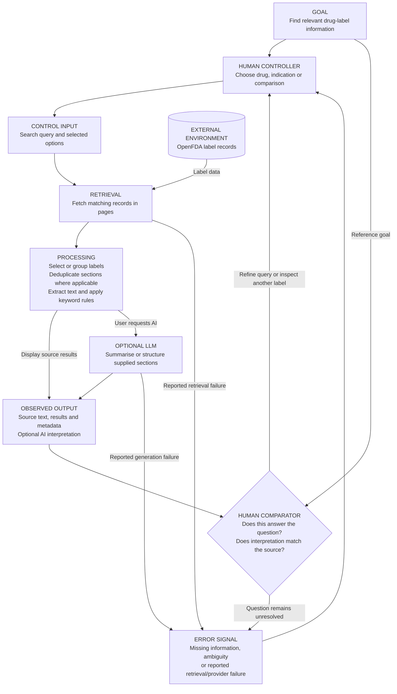

# FDA Drug Label Search v2

A fast, research-oriented web app for searching and analyzing U.S. FDA drug label data. Built with React + FastAPI on top of the public [OpenFDA](https://open.fda.gov/) API — no database required, all data is fetched live.

Designed for researchers and clinicians working with drug labels, especially psychiatric drug classes (antipsychotics, antidepressants, mood stabilizers).

---

## Features

| Feature | Description |
|---------|-------------|
| **Single drug search** | Look up any generic drug name; extracts key indications, metadata, and shows the most recent label |
| **Batch query** | Search multiple drugs at once with configurable rate limiting and preset lists (antipsychotics, antidepressants, mood stabilizers) |
| **CSV export** | Download batch results as CSV |
| **Label analysis** | Explore retrieved label dates, versions, formulations and indication-section differences in a visual timeline |
| **Indication search** | Reverse lookup — find all FDA-labeled drugs that mention a specific indication (e.g. "schizophrenia"), with live streaming progress |
| **AI summaries** | Optional structured indication summaries via OpenAI, DeepSeek, or Gemini |

---

## How it works: the feedback loop

The application is a human-controlled information system. You set the question, inspect retrieved source text and optional AI interpretation, then adjust the question. The comparison and feedback in this diagram describe the user's judgment; they are not automated clinical validation.



### Walk through the application

1. **Open Indication** in the navigation bar. In **Indication or Condition**, enter a term such as `schizophrenia`. Clicking a **Common searches** suggestion fills the field; it does not start the search.
2. **Click the magnifying-glass button**, or press Enter in the field. The backend asks OpenFDA for labels whose indication section matches the query and retrieves results in pages.
3. **Watch the Live Search Log** while records are fetched and grouped. The app groups matches by generic drug name, collects brand names and dates, and checks for monotherapy/adjunctive keywords. The log's “Summarizing labels” step is deterministic processing, not an LLM call.
4. **Review the drug cards.** Compare label counts, latest dates and keyword flags; use **Latest Date**, **A-Z** or **# Labels** to sort the cards. These flags summarize matched text, rather than proving that the searched condition has a particular approved treatment mode.
5. **Click a drug card or its View Timeline area.** This opens **Timeline** with the drug preselected and automatically loads its label analysis. This is a separate retrieval for the selected drug, not reuse of the entire indication-search result.
6. **Inspect the timeline, formulations, versions and indication text.** Dates and changes describe the records retrieved from OpenFDA. They do not establish a complete approval history or active marketing status.
7. **Optionally click Extract Indications** in the timeline page. With an OpenAI key configured on the server, or entered through **API Key**, the backend groups identical indication sections and sends those sections with label metadata to OpenAI. Inspect the returned indication/formulation information against the supplied text.
8. **For an individual summary, open Search**, enter the drug name and click **Search**. Review **Indications and Usage**, then optionally click **Generate AI Summary**. This sends the selected label's indication text to an available configured provider. Timeline extraction and single-label summaries are separate AI actions.
9. **Close the feedback loop:** compare the output with the original question and source text. Refine the search term, inspect another drug or formulation, or retry a reported failure. Corrections are not automatically learned or stored as clinical knowledge.

There is currently no autonomous parsing agent, vector retrieval/RAG pipeline, or persistent backend label/extraction cache. Some frontend queries briefly retain results in memory; repeated indication searches perform fresh retrievals. Persistent source storage, reuse of unchanged extractions and a calibrated evaluation loop are proposed extensions, not components shown as implemented above.

---

## Quick start

```bash
# Install all dependencies (frontend + backend)
npm run setup

# Start both frontend and backend
npm run dev
```

- **Frontend**: http://localhost:3000
- **Backend**: http://localhost:8000

---

## Stack

| Layer | Technology |
|-------|-----------|
| Frontend | React 18 · TypeScript · Vite · Tailwind CSS · React Router 6 · TanStack Query 5 |
| Backend | FastAPI · Python 3 · Uvicorn · httpx · pandas |
| Data source | [OpenFDA drug/label API](https://open.fda.gov/apis/drug/label/) (no key required) |
| Infra (optional) | Docker · docker-compose · nginx |

---

## Project structure

```
fda_v2/
├── frontend/
│   └── src/
│       ├── pages/
│       │   ├── SearchPage.tsx          # Single drug search
│       │   ├── BatchQueryPage.tsx      # Multi-drug batch
│       │   ├── LabelAnalysisPage.tsx   # Label version timeline
│       │   └── IndicationSearchPage.tsx # Reverse indication lookup
│       ├── services/api.ts             # API client
│       └── types/index.ts
├── backend/
│   ├── main.py                         # All API logic (~1300 lines)
│   ├── uk_scraper.py                   # Standalone UK eMC scraper (not mounted)
│   └── requirements.txt
├── docker-compose.yml
├── Makefile
└── .env.example
```

---

## API endpoints

| Method | Path | Description |
|--------|------|-------------|
| `GET` | `/api/drugs/search/{drug}` | Single drug — best label + extracted indications |
| `GET` | `/api/drugs/search/{drug}/stream` | SSE stream with progress events |
| `POST` | `/api/drugs/batch` | Batch search `{ drugs[], rate_limit_delay? }` |
| `GET` | `/api/drugs/lists` | Preset drug name lists |
| `GET` | `/api/drugs/analyze-labels/{drug}` | Retrieved labels, formulation/version metadata and indication-section differences |
| `GET` | `/api/indications/search/{term}/stream` | SSE indication search with live logs |
| `POST` | `/api/export/csv` | Export results as CSV download |

```bash
# Quick sanity checks
curl http://localhost:8000/
curl http://localhost:8000/api/drugs/search/risperidone
curl -X POST http://localhost:8000/api/drugs/batch \
  -H "Content-Type: application/json" \
  -d '{"drugs": ["risperidone", "olanzapine"], "rate_limit_delay": 0.3}'
```

---

## Optional AI summaries

Set one of these in `backend/.env` to enable structured indication summaries:

```env
GEMINI_API_KEY=...
OPENAI_API_KEY=...
DEEPSEEK_API_KEY=...
```

The provider is selected automatically in priority order: OpenAI → DeepSeek → Gemini. Override the model with `AI_MODEL` (e.g. `models/gemini-1.5-pro-latest`).

---

## Docker

```bash
docker-compose up         # builds and starts all services
docker-compose up --build # force rebuild
```

Services: `frontend` (nginx, port 80), `backend` (uvicorn, port 8000), `postgres`, `redis`.

> PostgreSQL and Redis are configured in docker-compose but not yet connected to the application logic — reserved for future persistence and caching.

---

## Interpreting label dates and versions

The label analysis endpoint reports source dates, versions, formulations and indication-section differences. It does not classify labels as active, likely active or outdated. The separate manual script `backend/test_all_indications.py` contains age-based status heuristics; those heuristics are not used by the application endpoint.

An effective date or the first appearance of text in the fetched records does not establish the first FDA approval date. OpenFDA also cautions that submitted labeling may differ from approved labeling; see the [dataset overview and limitations](https://open.fda.gov/apis/drug/label/).

---

## Environment variables

See `.env.example` for all available variables. The only required one for the app to function is none — OpenFDA requires no API key.
